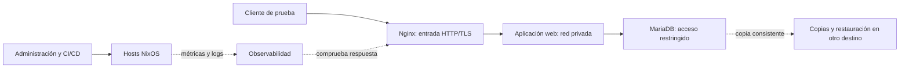

# Infraestructura de prueba

## Objetivo

Construir y operar por etapas un laboratorio de infraestructura con NixOS que me permita
aprender prácticas de DevOps: administrar servidores Linux, conectar servicios, automatizar
cambios, probar despliegues, proteger secretos, observar fallos y recuperar sistemas y datos.

Usaré máquinas virtuales y contenedores para servir una aplicación con datos persistentes,
separar el acceso público de los servicios internos y demostrar su funcionamiento desde
un cliente. Incorporaré tecnologías de mis clases cuando aporten una práctica concreta.
Registraré decisiones, pruebas, incidentes y recuperación para poder explicarlos y repetirlos.

## Estado actual

Proyecto iniciado: flake con devShell y formateador; aún sin hosts en
`nixosConfigurations`. La arquitectura siguiente es una propuesta de aprendizaje,
no infraestructura ya desplegada. La serie recorre E0–E12, con episodios divididos
cuando el tema requiere dos entregas.

## Arquitectura propuesta

Separaré responsabilidades antes de separar máquinas. Comenzaré con `srv-01`; los demás
roles se incorporan cuando su episodio los necesita y pueden compartir VM al principio.
Separar un rol después exige repetir las pruebas de red, permisos, datos y recuperación.

El diagrama muestra flujos lógicos, no reglas de red ya configuradas. DNS, sincronización
horaria y acceso administrativo sostienen esos flujos. En la práctica perimetral se
separan WAN simulada, DMZ y LAN; WireGuard proporciona acceso administrativo remoto. La base de datos solo admitirá los
clientes necesarios; los paneles administrativos se mantendrán en la red de administración.

| Rol | Composición propuesta | Qué tengo que demostrar |
| --- | --- | --- |
| Servicio inicial: `srv-01` | NixOS, OpenSSH, systemd y pedco-bot según E1–E5 | Instalación repetible, activación, secretos, fallo y recuperación |
| Entrada y aplicación web | Nginx; reutilizar Apache/PHP y Node.js del TP4 con Podman | DNS/TLS, rutas correctas, contenido esperado y diagnóstico de errores |
| Datos | MariaDB, usuarios con permisos restringidos y almacenamiento persistente | Escribir/leer desde la aplicación, conservar datos y restaurar una copia |
| Operación | Prometheus, exporters, Grafana y Alertmanager; Loki y Alloy al centralizar logs | Detectar un fallo, recibir alerta, encontrar causa y comprobar recuperación |
| Frontera, por práctica de T8/E8 | Router/firewall con WAN simulada, DMZ y LAN; WireGuard y Fail2ban | NAT, reglas de reenvío, acceso administrativo y bloqueos comprobados |
| Servicios internos, por práctica | CoreDNS; OpenLDAP/LAM, NFS/Samba y CUPS en la red interna | Resolución, permisos, autenticación o una operación real desde un cliente |
| Cliente de contraste | Reutilizar una VM Ubuntu del laboratorio si sigue disponible | Acceso desde fuera del servidor y comparación de administración; Ansible en E12 |

**Dos cargas con propósitos distintos:** pedco-bot sigue siendo el servicio de los primeros
episodios. El stack web del TP4 aporta HTTP, proxy y MariaDB en el arco de contenedores.
No convertiré el bot en una aplicación con MariaDB solo para llenar el diagrama.

El backend Node.js revisado del TP4 devuelve texto y no consulta la base. Para demostrar
el recorrido completo añadiré, cuando toque esa práctica, una operación pequeña de
escritura/lectura con datos sintéticos. No daré por probado ese recorrido por tener
contenedores encendidos.

## Construcción por episodios

| Episodio | Qué construyo o compruebo |
| --- | --- |
| E0 | Repositorio, entorno mínimo y explicación del proyecto |
| E1 | Primer servidor virtual NixOS: instalación, red y SSH |
| E2 | Cambio remoto, actualización, fallos y recuperación de generaciones |
| E3 | Servicio propio mediante módulo NixOS y unidad systemd |
| E4 | Secretos, rotación y recuperación de datos y claves |
| E5 | Pruebas de integración del servicio y de sus fallos |
| E6a | Pipeline convencional: pruebas, build y artefactos identificables |
| E6b | Pipeline con Nix y entorno reproducible para desarrollar |
| E7 | Contenedores: Dockerfile e imagen Nix; comparación con Podman y stack web del TP4 |
| E8a | Recursos de nube con OpenTofu: red, firewall y state recuperable |
| E8b | Instalación automatizada de NixOS en esos recursos |
| E9 | Flota con Colmena o deploy-rs; canary, salud y promoción aprobada |
| E10a | Kubernetes con k3s: nodos, red, servicios, despliegue y diagnóstico |
| E10b | Configuración, permisos, recursos y persistencia; comparar con la etapa anterior |
| E11 | Métricas, logs, alertas, objetivos de servicio y ejercicio de incidente |
| E12 | Ansible y elección de herramientas según el entorno y el equipo |

Desde E1 usaré estado, logs y pruebas manuales del servicio. Las alertas básicas se
incorporan al introducir el servicio; E11 integra y profundiza observabilidad. No esperaré
a E11 para comprobar si una aplicación responde.

Kubernetes llega después de operar servicios y contenedores. Su práctica reutiliza lo ya
entendido; no exige ejecutar simultáneamente todas las versiones del laboratorio.

## Integración con clases

Revisión del 2026-11-01: leí las consignas locales TP1–TP4 de Administración de Servicios
y TP3 de Automatización y Scripting; también recuperé y leí desde PEDCO Servicios TP5
y Automatización TP4. Son material de entrada, no una receta empresarial
que deba trasladarse sin evaluar.

| Material revisado | Integración en este laboratorio |
| --- | --- |
| Servicios TP1: SSH, chrony/NTP, systemd/OpenRC y Podman rootless | Acceso y operación inicial; contraste con la VM clásica |
| Servicios TP2: NFSv4, Samba, CUPS y Kea DHCP | Prácticas internas con cliente; Kea solo en red aislada sin DHCP competidor |
| Servicios TP3: CoreDNS, OpenLDAP y LAM | DNS del laboratorio; identidad como práctica separada con usuario de prueba |
| Servicios TP4: Nginx, Apache/PHP, Node.js, MariaDB y Podman Compose | Reutilización del stack en E7, pruebas funcionales y backup consistente |
| Automatización TP3: cron, at, timers, journalctl, grep/sed/awk | Tareas programadas, diagnóstico y procesamiento de logs |
| Automatización TP4: GoAccess, Compose, Ansible y GitHub Actions | E6/E7 para imágenes, logs web y CI; E12 para administración idempotente en Ubuntu |
| Servicios TP5: IPTables, NAT/DMZ, Rsyslog, Fail2ban y WireGuard | T8/E8 para segmentación y administración; E11 para comparar colector syslog y Loki |

DHCP tendrá su propia red virtual aislada: sin puente hacia la LAN doméstica y sin el
DHCP de libvirt compitiendo en ese segmento. Los servicios de impresión, archivos e
identidad se levantan para su ejercicio; no son dependencias obligatorias de la web.

El TP5 se reproduce primero con su topología aislada en Ubuntu. Luego se compara su
política con la configuración declarativa NixOS: no ejecutar su script IPTables sobre
victus ni mezclar dos gestores del mismo firewall. Rsyslog/GoAccess y Loki/Grafana tienen
propósitos que compararemos con el mismo evento de prueba, sin instalar todos a la vez.

PEDCO también mostró una clase sobre AppArmor; no leí su documento completo ni lo
convierto en requisito de arquitectura por su título. Las IP, imágenes, capacidades de
contenedor y contraseñas de ejemplo de las consignas se revisan al ejecutar: un enunciado
no acredita que una configuración sea adecuada para exponer un servicio real.

## Criterios de operación y cierre

- Distinguir desarrollo, prueba y despliegue mediante configuraciones, datos y credenciales
  separados. Empezar con un entorno de laboratorio; crear otro al probar promoción entre ellos.
- Probar el servicio desde un cliente: DNS, TLS, estado HTTP, contenido y operación con datos.
  Un contenedor activo o una conexión SSH exitosa no prueban toda la aplicación.
- Automatizar una cadena verificable: commit, checks, build, artefacto, aprobación,
  despliegue de prueba, salud y promoción. Un fallo requerido detiene la promoción.
- Medir disponibilidad y latencia desde fuera; errores, tráfico y saturación desde dentro.
  Correlacionar logs y métricas. Incorporar trazas solo si diagnosticar un flujo distribuido
  requiere esa evidencia adicional.
- Definir un objetivo de servicio y objetivos de pérdida de datos y tiempo de recuperación
  (RPO/RTO); probarlos con incidentes controlados y escribir un postmortem breve.
- Respaldar MariaDB con un método consistente: dump apropiado, herramienta de backup
  compatible o copia en frío. Un tar de un volumen mientras la base escribe no demuestra
  una copia restaurable. Comprobar restauración en un destino distinto.
- Conservar al menos una copia fuera del equipo físico antes de considerar cubierta su pérdida.
  Una segunda VM en la misma laptop solo permite ensayar restauración, no protege de perderla.

## Capacidad y límites

Las asignaciones de CPU, RAM, disco y retención se decidirán y medirán al crear cada VM.
Mantendré encendidos solo los perfiles necesarios y controlaré el crecimiento de imágenes,
volúmenes y logs. No fijaré ahora una cantidad final de VMs ni un presupuesto de nube.

Varias VMs en una laptop comparten energía, disco e hipervisor: no constituyen alta
disponibilidad ante la caída de esa laptop. El cluster permite aprender distribución,
reprogramación y fallos de nodo; la disponibilidad física exige otros dominios de fallo.
El acceso público y cualquier gasto cloud se habilitan en su etapa con alcance definido.

## Sustento de la propuesta

La selección y la secuencia son decisiones de este laboratorio. Las fuentes describen
patrones y capacidades; no demuestran que esta composición sea la más usada por todas
las empresas ni que el laboratorio tenga garantías de producción.

- [Arquitectura web por capas: referencia práctica de AWS](https://github.com/aws-samples/aws-three-tier-web-architecture-workshop).
- [Google SRE: señales y comprobaciones de monitorización](https://sre.google/sre-book/monitoring-distributed-systems/).
- [Kubernetes: decisiones para un entorno de producción](https://kubernetes.io/docs/setup/production-environment/).
- [MariaDB: métodos de backup y restauración](https://mariadb.com/docs/server/server-usage/backup-and-restore/backup-and-restore-overview).
- [Grafana: fin de soporte de Promtail y migración a Alloy](https://grafana.com/docs/loki/latest/send-data/promtail/).

## Cómo seguir la serie

Canal y artículos: por definir. El código mostrará el estado real de cada episodio;
las capacidades propuestas se marcarán como demostradas únicamente después de sus pruebas.
